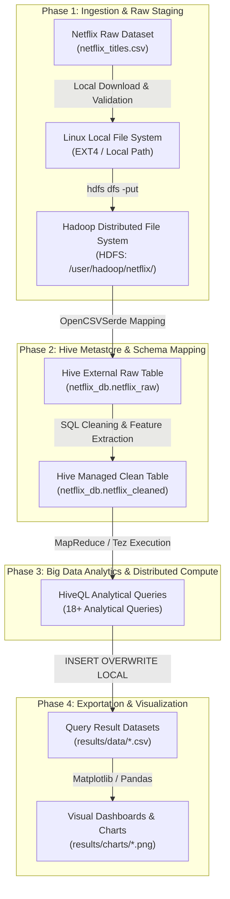

# System Architecture & Data Flow

This document details the multi-tiered Big Data pipeline architecture used in the **“Netflix Movies and TV Shows Data Analysis using Hadoop and Hive”** micro-project.

---

## 1. High-Level Architecture Overview

---

## 2. Architectural Pipeline Stages

### Stage 1: Data Collection & Staging (Linux File System)
- **Input Data:** `netflix_titles.csv` containing 6,234 rows with 12 attributes.
- **Role:** Stored in the local file system (`dataset/netflix_titles.csv`). The data undergoes local structural checks (row count verification, comma delimiter inspection) before entering the distributed cluster.

### Stage 2: Distributed Storage (Hadoop HDFS)
- **Target Path:** `/user/hadoop/netflix/netflix_titles.csv`
- **HDFS Mechanics:**
  - Files are split into fixed-size data blocks (default: 128 MB in Hadoop 2.x/3.x).
  - The **NameNode** manages namespace metadata, directory tree structure, and block-to-DataNode mappings in RAM and persists state via `fsimage` and `edits`.
  - The **DataNodes** store the actual block replicas across physical disks (default replication factor = 3; or 1 in pseudo-distributed mode).
  - Provides high availability, fault tolerance, and horizontal scalability for PB-scale expansion.

### Stage 3: Schema-on-Read Staging (Hive External Table)
- **Table Name:** `netflix_db.netflix_raw`
- **Table Type:** `EXTERNAL TABLE`
- **Key Concept:** **Schema-on-Read**. Hive applies structure to the raw text file without moving or transforming the underlying HDFS bytes.
- **SerDe (Serializer/Deserializer):** Uses `org.apache.hadoop.hive.serde2.OpenCSVSerde` to parse RFC-4180 CSV syntax. This correctly handles double-quoted strings with embedded commas (such as multi-country releases or composite director credits).

### Stage 4: Data Cleansing & Feature Engineering (Hive Managed Table)
- **Table Name:** `netflix_db.netflix_cleaned`
- **Table Type:** `MANAGED TABLE (INTERNAL)` stored as **ORC (Optimized Row Columnar)** format with **Snappy compression**.
- **Transformations Executed:**
  - Standardized missing values and blanks into `'Unknown Director'`, `'Unknown Cast'`, `'Unknown Country'`, and `'Unrated'`.
  - Cast `release_year` into `INT`.
  - Extracted `added_year` as `INT` from `date_added`.
  - Split compound duration strings (`"90 min"`, `"3 Seasons"`) into `duration_value (INT)` and `duration_unit (STRING)`.
  - Filtered invalid corrupt records.

### Stage 5: Analytical Processing (HiveQL & Execution Engines)
- Analytical queries run against `netflix_cleaned`.
- Hive’s query compiler translates declarative HiveQL into a Directed Acyclic Graph (DAG) executed via **MapReduce** or **Apache Tez**.
- Aggregations (`COUNT`, `AVG`, `MIN`, `MAX`), groupings (`GROUP BY`), and explosions (`LATERAL VIEW explode()`) run in parallel across cluster worker nodes.

### Stage 6: Reporting and Business Intelligence
- Results are exported to CSV format.
- A lightweight visualization script generates publication-grade visualizations for academic review and executive reporting.
